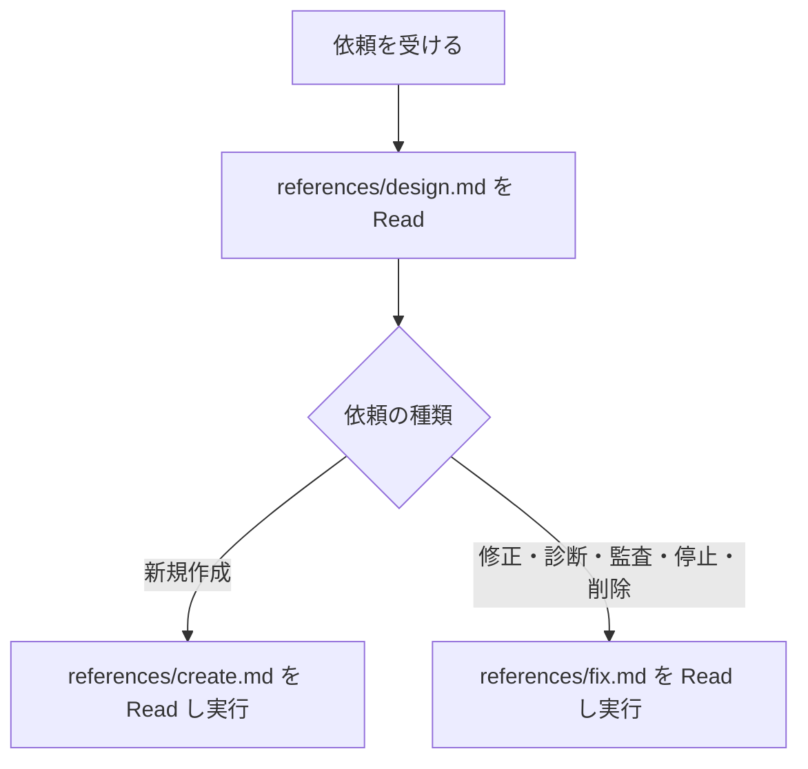

# automation — 放置して使い続けられる Orbe の自動化を設計・改善する

Orbe の自動化は、ノード（取得・処理・判定・報告・作業・外部操作）をつないだグラフで、ノードごとにバックグラウンドでスケジュールに従って動く。目的は「とりあえず動く定義」を置くことではなく、**ノイズが少なく、判断に必要な文脈が揃い、無駄なコストをかけずに毎日放置で使い続けられる自動化**を仕上げることである。

定義の形式・制約・既定値・上限は、Orbe の MCP の `set_automation` などの説明が正本である。説明が途中で切れている場合はコマンド orb automation --help で全文を読む。

## 役目の境界

- 書くのは自動化の定義と、自動化が呼び出すローカルのスクリプトだけ。タスクを追加・編集しない、判定ノードが出すタスク候補をタスクにしない（人がタスク画面で採否を決める）、依頼にある実作業そのものを代行しない。依頼に書いてあってもしない。
- 判断が必要な箇所は AskUserQuestion で人に聞く。文章の末尾に質問を書いて終わらない。やり取りは依頼の言語で行う。
- 保存前の定義を `try_automation` でテスト実行し、実出力の品質を確かめる。人が良いと言うまで `set_automation` で本番に保存しない。確認のために `run_automation` で本番を動かさない（外部操作と作業が本当に動く）。

## 常に適用される設計原則

1. **実データを見てから設計する**: 案や判定基準を出す前に、副作用のない読み取り手段で実データを数件取得し、返ってくるデータ構造・本文の情報量・ノイズの実態・認証とバックグラウンド実行時の利用可否を確かめる。
2. **決定論的な処理はコード、意味判断だけ LLM**: 対応済みの除外、整形、スレッド集約、条件で決まる絞り込みはコマンド（複雑なものは Orbe の Home 配下のスクリプト）で担う。agent が担うのは、要約、自律操作、文脈を読まないと決まらない判断、具体的な行動を表すタスクタイトルの作成だけに絞る。
3. **下流が迷わない情報密度を保つ**: タイトルだけの貧弱な取得も、1 項目（ノード間で渡す 1 行）あたり 64 KiB の上限を圧迫する生ダンプも避ける。下流が 1 回で正しく判断できる文脈（本文・最新返信・状態・送り手・リンク）を簡潔に整形して渡す。
4. **テスト実行を品質ゲートにする**: 失敗が無いだけで通さず、取得した各項目（行）の質、候補のタイトルと提案理由の具体性、見落としや放置運用時の罠の有無に加え、報告の 1 行目が通知だけで要点の伝わる要約になっているかを自分で監査し、粗を直してから人に見せる。

## 進め方

- コマンド出力のローカル検証スクリプト: ${CLAUDE_SKILL_DIR}/scripts/check-jsonl.pl（手順内でこのパスを使う）。

1. まず references/design.md を Read で読み込み、自動化の設計基準とバックグラウンド実行の制約を頭に入れる。グラフ構成や指示文の具体例が要るときは references/patterns.md を Read で読み込む。
2. 依頼の種類に応じて排他的に分岐する。
   - **新規作成**（「○○を自動で拾って」「毎朝○○をまとめて」「毎朝○○を自動投稿して」「○○の自動化を作って」など）: references/create.md を Read で読み込み、手順どおりに進める。
   - **修正・診断・品質監査・停止・削除**（「自動化 N を直す」「失敗している原因を調べて」「ノイズが多い」「今ある自動化を見直して」「一時停止して・消して」など）: references/fix.md を Read で読み込み、手順どおりに進める。
