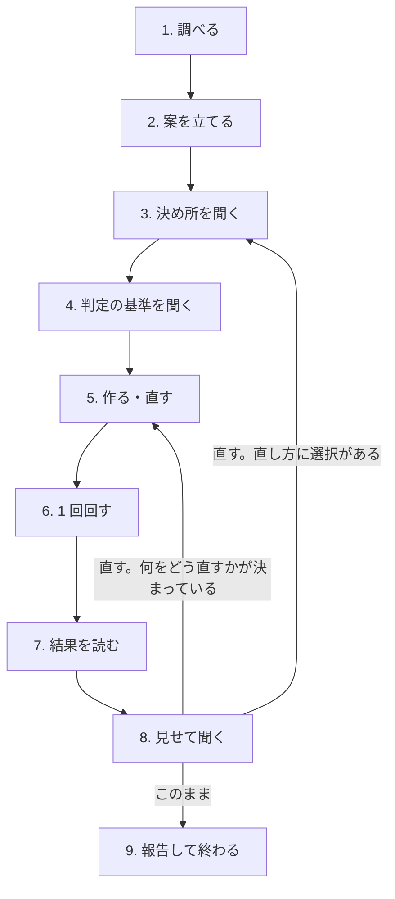

# automation — Orbe の自動化を、人と決めながら作る・直す

Orbe の自動化は、トリガー → 取得元 → 処理の段 → 出力先 の定義 1 つで動く。定義の項目と仕組みは Orbe の MCP の `set_automation` の説明が持つ。このスキルが持つのは進め方で、人が一言頼めば、調べる・案を立てる・聞く・作る・回す・見せる・直す、を人が「このまま」と言うまで繰り返す。

## 役目の境界

- 書くのは自動化の定義だけ。タスクを足さない・直さない、候補をタスクにしない（人が ⌘⇧X でさばく）、作業そのものをしない。頼みに書いてあってもしない。
- 人とのやり取りは頼みの言語で行う。

## 常に効く決まり

- **決め所は人が決める。** 出どころと範囲・判定の基準・間隔・型から外れること・有効にすること。AskUserQuestion で聞く。文章の末尾に問いを置いて終わらない。
- **試し打ちの結果を見せるまで終わらない。** 作っただけ・直しただけで報告しない。
- 取る手段を調べ切ってから案を立てる。コマンドで取れる出どころを agent で取る案は、調べていない印。

## 手順

### 1. 調べる

頼みに出た手がかり（フォルダ・ノート・サービス名）を読む。`list_automations` で今ある自動化を見る（重なり・直す対象の `definition` と `runs`）。候補を出す自動化は `list_automation_proposals` で候補も見る。

出どころごとに、取る手段を確かめる:

- コマンドで取れるか: `gh`・`curl` などの CLI と、その認証が通っているか。
- コマンドで取れなければ、自分に見えている MCP の読み取りツール（`mcp__<サーバー>__<ツール>`）。

付け先にできる workspace は `list_workspaces` で見る。

### 2. 案を立てる

`references/patterns.md` を Read し、出どころごとに 1 つの自動化として型を当てる。型は参考で、頼みに合わなければ外れた形を作り、外れた理由と代替を 3 の選択肢に書く。範囲（組織・状態・期間）と間隔の案もここで作る。

直しなら、`runs` の `failure`・`rejected.reasons`・`fresh` と候補の数の比・候補のタイトルの偏りから、何が起きているかを診断し、直し方の案を作る。

### 3. 決め所を聞く

AskUserQuestion 1 度で聞く。

- 新しく作る: 出どころ（複数選択。見つけたものを選択肢にし、取る手段を description に書く）・間隔・型から外れる案の可否（あれば）。
- 直す: 診断を question に書き、直し方の案を選択肢にする。

### 4. 判定の基準を聞く

候補を出す自動化だけ。3 とは別の AskUserQuestion で、選ばれた出どころごとに 1 問。選択肢は、具体に書いた案と、広い案・狭い案。どの案も「タスクにする」と「タスクにしない」の両方を持つ。

### 5. 作る・直す

`set_automation` で書く。直すときは `list_automations` の `definition` を取り、直して丸ごと送る。

### 6. 1 回回す

`run_automation` で回し、`list_automations` の `running` が false になるまで待つ。

### 7. 結果を読む

`runs` の先頭の回を読む: `failure`、`source.rejected.reasons`、`steps[].rejected.reasons`、`fresh` と出力先の数（候補なら `sink.proposed`）。候補を出す自動化は `list_automation_proposals` でタイトルを読む。取得がコマンドなら自分でも走らせ、候補にならなかった項目に拾うべきものが無いかを見る。

候補が 0 件の回も、新しい項目の全部が候補になった回も、基準が効いていない印。

### 8. 見せて聞く

AskUserQuestion で、自動化ごとに「候補の数・代表 2〜3 件・落とした例・失敗」を question に書き、選択肢を「このまま／基準を直す／範囲や取り方を直す／捨てる」にする。

- 直す: 何をどう直すかが決まっていれば 5 へ。直し方に選択があれば 3 へ。
- 捨てる: `delete_automation`。
- このまま: 9 へ。止めてあれば `pause_automation` で再開する。

### 9. 報告して終わる

自動化ごとに 1 行: 取得の手段（コマンドか agent か。agent なら毎回 LLM が起きること）・判定の基準・間隔。
