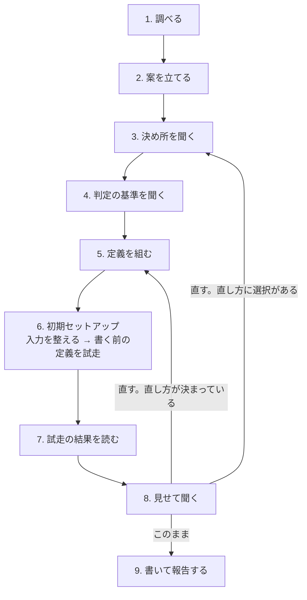

# automation — Orbe の自動化を、人と決めながら作る・直す

Orbe の自動化は、ノード（取得・処理・判定・報告・作業・外部操作）をつないだグラフで、ノードはそれぞれ自分の予定で動く。定義の形と仕組みは Orbe の MCP の `set_automation` の説明が持ち、回の記録・試走・候補の形はそれぞれの道具の説明が持つ。このスキルが持つのは進め方で、人が一言頼めば、調べる・案を立てる・聞く・組む・試走で確かめる・見せる・直す、を人が「このまま」と言うまで繰り返し、それから書く。

## 役目の境界

- 書くのは自動化の定義だけ。タスクを足さない・直さない、候補をタスクにしない（人が ⌘⇧X でさばく）、作業そのものをしない。頼みに書いてあってもしない。
- 人とのやり取りは頼みの言語で行う。

## 常に効く決まり

- **決め所は人が決める。** 出どころと範囲・判定の基準・予定・型から外れること・書いて動かし始めること。AskUserQuestion で聞く。文章の末尾に問いを置いて終わらない。
- **人が試走の結果を見て良いと言うまで、定義を書かない。** 作るときも直すときも、`set_automation` を呼ぶのは最後の 1 回だけ。確かめには書く前の定義の試走（`try_automation`）を使い、`run_automation` で本番を動かして確かめない（外部操作と作業が本当に動く）。
- 取る手段を調べ切ってから案を立てる。コマンドで取れる出どころを agent で取る案は、調べていない印。
- 既定の値と上限の数は覚えて書かない。要るときは道具の説明を読む。

## 手順

### 1. 調べる

- 頼みに出た手がかり（フォルダ・ノート・サービス名）を読む。
- `list_automations` で今ある自動化の `definition` とノードの状態を見る（重なりと、直す対象）。
- 直すときは、対象のノードの過去の回を `list_automation_runs` で読む（`failure`・外れた件の `reasons`・`dropped`・`result`）。報告と作業の全文は一覧に無いので、ノードを指して少ない件数で読む。
- 候補を出す自動化は `list_automation_proposals` で候補も見る（タスクにした・捨てた・対応済みの偏り）。
- 付け先にできる workspace は `list_workspaces` で見る。
- 出どころごとに、取る手段を確かめる。まずコマンド（gh・curl などの CLI と、その認証が通っているか）。コマンドで取れなければ、自分に見えている MCP の読み取りのツール（mcp__<サーバー>__<ツール>）。

### 2. 案を立てる

references/patterns.md を Read し、頼みに型を当てる。型は参考で、頼みに合わなければ外れた形を作り、外れた理由と代替を 3 の選択肢に書く。

- 出どころごとに取得のノードを 1 つ置き、予定はノードごとに、出どころの速さと費用で決める。範囲（組織・状態・期間・宛先）は取得の条件で切る。
- 取得の `coverage` は、出どころの振る舞いで選ぶ。取るたびにその時点の全体が返り、終わったもの（閉じた課題・済んだレビュー依頼）が結果から消えるなら `currentSet`。新着だけが返るなら `newArrivals`。
- 1 つの候補にまとめたい出どころは、1 つの判定に入力を集める。合流の間に、出来事の流れを出す処理（`coverage` が `newArrivals` か省略の処理）を挟まない。その処理が新しい `id` で作った行から出た候補は、元の項目が取得の結果から消えても、出来事を残す期間（`retentionDays`）を過ぎるまで ⌘⇧X の候補の一覧から下がらない。
- 取得と処理は、候補にしたい行に `link` を残す。
- 頻繁に回るノードには軽いモデルを選ぶ。
- 重いノード（大きな取得・長い作業）は、1 回にかかる時間を見積もり、余裕を持たせた `timeoutMinutes` を書く。見積もりは 7 で試走の回の長さと突き合わせる。
- 費用と鮮度を抑えたい受け手には `maxItems` と `maxAgeHours` を、長い窓で読む判定の出どころには `retentionDays` を書く。
- 行を受けるコマンドが外の API に id を渡すなら、id の接頭（ノードの ID と「:」）を外す（理由は `set_automation` の説明の ROWS）。
- 直すときは、回の記録と候補から何が起きているかを診断する（どのノードで落ちたか・外れた件・捨てた数・新しい行の数と候補の数の比・候補のタイトルの偏り）。そのうえで直し方の案を作る。

### 3. 決め所を聞く

AskUserQuestion 1 度で聞く。

- 新しく作る: 出どころ（複数選択。見つけたものを選択肢にし、取る手段を description に書く）・予定・型から外れる案の可否（あれば）。取得が agent になる出どころは、回ごとに LLM が起きることも description に書く。
- 直す: 診断を question に書き、直し方の案を選択肢にする。
- 受け手（判定・報告・外部操作）を新しく置くとき: 初回に上流の今ある分が届く（届き方は `set_automation` の説明の WHAT A RECEIVER READS）。今ある分も対象にするか、これから来る分だけにするかを選択肢にする。

### 4. 判定の基準を聞く

候補を出す自動化だけ。3 とは別の AskUserQuestion で、選ばれた出どころごとに 1 問。選択肢は、具体に書いた案と、広い案・狭い案。どの案も「タスクにする」と「タスクにしない」の両方を持つ。

- 出来事の流れ（`newArrivals`）を読む判定の指示文には、「終わったもの（自分が返信した・PR が閉じた など）は対応済みにする」を必ず入れる。入れないと、終わった候補が、出来事を残す期間（`retentionDays`）を過ぎるまで ⌘⇧X の候補の一覧に残る。
- 判定をコマンドにする案では、コマンドの判定は対応済みにできないことを description に書く。

### 5. 定義を組む

型と `set_automation` の説明に沿って、定義の JSON を組む。

- 直すときは、`list_automations` の `definition` と `version` を取り、直して丸ごと組む。残すノードは `id` を保つ（鍵を変えても同じノードのまま）。
- 一時的に止めたいノードは、定義から外さず `pause_automation` で止める（外すと、出した行と読んでいない行が消える）。

### 6. 初期セットアップ

本番に書く前に、次の回以降の入力を整え、書く前の定義を試走で確かめる。

1. **入力を整える。** 3 で決めた初回の届き方になるよう、取得の条件か手元の状態で整える。既に読んだ行を新しい基準で見直したい（既存の分を判定し直すなど）なら、そう届く形に組む（Orbe は見直さない。`set_automation` の説明の REWRITING）。コマンドが読み書きする手元の状態（スクリプト・設定ファイル・記録の置き場）は、普段の手段で用意する。
2. **試走する。** `try_automation` に書く前の定義を渡し（直すときは `automationId` と `version` も）、入口から終わりまで実行する。
   - 取得は本当に走る。取得の agent に書き込みのツールを渡していないかを先に確かめる。
   - 重い取得は、取得の条件を絞るか、`limit` で行の数を絞る。取得を走らせたくなければ、入口に `rows` を与える。判定を試すなら、候補にしたい行に `link` を持たせる。
   - 外部操作と作業のノードは動かず、渡るはずだった行が返る。
3. **終わりまで待つ。** `get_automation_trial` を `wait` 付きで呼び、`timeoutMs` を明示する。時間切れなら待ち直す。

### 7. 試走の結果を読む

ノードごとに読む。

- 回の `failure` と外れた件の `reasons`（どこで落ちたか）。
- 取得と処理の `rows`（下流へ渡る行。`link` が残っているか）。
- 判定の `proposals`（タイトル・期限・付け先・理由）と `resolved`。候補が 0 件の回も、新しい行の全部が候補になった回も、基準が効いていない印。
- 外部操作と作業の `held` の行（何が渡るはずだったか）と、報告の文（`text`）。
- 直す試走では、`atWrite` の付いた回（書いた瞬間に本番で動く分）を、付いていない回（試走が入口から流した分）と分けて読む。
- 回の長さ（`startedAt` から `endedAt`）。`timeoutMinutes` の見積もりを見直す。
- 取得がコマンドなら自分でも走らせ、候補にならなかった項目に拾うべきものが無いかを見る。

### 8. 見せて聞く

AskUserQuestion で、自動化ごとに試走で起きたこと（候補の数・代表 2〜3 件・落とした例・報告の文の冒頭・外部操作と作業に渡るはずだった行・失敗）を question に書く。選択肢は「このまま書く／基準を直す／範囲や取り方を直す／やめる」。

- 候補を出す自動化では、終わった候補が ⌘⇧X の候補の一覧から自動で下がること（下がり方は `set_automation` の説明の JUDGE）を一度伝える。
- 直す: 直し方が決まっていれば 5 へ。直し方に選択があれば 3 へ。
- やめる: 何も書かずに終える（直すときは、本番の定義はそのまま残る）。自動化そのものを消したいと言われたら `delete_automation`。
- このまま書く: 9 へ。

### 9. 書いて報告する

- `set_automation` で書く（直すときは読んだ `version` を添える）。`version` の食い違いでエラーが返ったら、読み直して変わった所を人に伝え、5 からやり直す。
- 本番の初回は予定で回る。人が今すぐ動かしたいと言えば `run_automation`。
- ノードごとに 1 行で報告する: 取得の手段（コマンドか agent か。agent なら回ごとに LLM が起きる）・判定の基準・予定。
