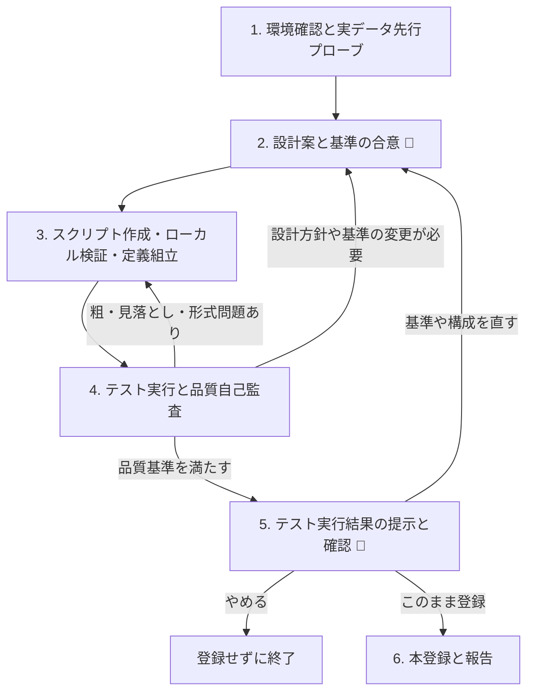

# 新規作成と品質検証の手順

references/design.md の基準を前提に、実データの観察から始めて、品質監査を通過した自動化を登録する。



## 1. 環境確認と実データ先行プローブ

並列で手元と Orbe の現状を調べる。

- `list_automations` で既存の自動化との重なりを確認する（既存へ統合した方が良いなら案に含める）。
- `list_workspaces` でタスク候補の紐付け先となる workspace 一覧と、Home（hasBoard が true の workspace）のパスを確認する。
- 依頼に出た手がかり（リポジトリ・ノート・設定）を読み、対象サービスに関連するローカル設定や接続先も確認する。
- データソースごとに取得手段を確かめる。まず認証済みの CLI・API（gh・curl・既存スクリプト等）を選び、コマンドで取れない場合だけユーザー設定（user スコープ）に登録済みの読み取り専用 MCP ツール（mcp__<サーバー>__<ツール>）を選ぶ（登録スコープが曖昧なら claude mcp list 等で確認する）。
- **実データを数件プローブする**: 副作用のない読み取りコマンドまたは読み取り専用 MCP を実際に叩き、直近 5〜10 件の生データを観察する。次を把握する。
  - 返るフィールドと本文の情報量（タイトルだけか、本文・コメント・スレッド・レビュー状態まで取れるか）
  - 想定件数と更新頻度、1 件あたりのデータサイズ
  - 実際のノイズの傾向（bot・定型通知・draft・自分が既に返信や承認を済ませたもの）
  - 欠落しやすい項目（URL・日時）と、ユーザー ID から表示名への変換要否

認証切れ・ツール不在・対象の特定不能など自力で進められない問題があれば、設計に進む前に AskUserQuestion で人へ伝えて解消する。

## 2. 設計案と基準の合意

設計案を組む前に `set_automation` の説明（途中で切れている場合はコマンド orb automation --help）で定義の制約と上限を確かめる。そのうえで references/design.md の基準に沿って、グラフ・手段（コマンド／Orbe の Home 配下のスクリプト／agent）・モデル・スケジュール・上限・通知・役割別の基準を組み立てる（必要なら references/patterns.md を Read で参照する）。

AskUserQuestion 1 回を基本に、実データから見えた傾向を添えて、決めるべき点をまとめて確認する（複数のデータソースがあり、判定基準が独立していて複雑なときだけ、判定基準の AskUserQuestion を分けてよい）。

- **データソース・取得範囲・手段**: プローブで見えた実態（件数やノイズ源）と取得手段を AskUserQuestion の選択肢の description に書く。agent 取得になるデータソースは毎回 LLM が起動することを明記する。Orbe の Home 配下にスクリプトを作る場合は配置先も伝える。
- **判定基準／報告・作業の基準**:
  - 候補を出す自動化は、実データの具体例を踏まえた推奨案と広め・狭めの案を並べ、どの案にも「タスクにする」と「タスクにしない」の両方を具体的に書く。
  - 関連メッセージに同じ `link` を持たせるデータソース（スレッド等）では、人が候補をタスク化または却下したあと、Orbe がその履歴を保持している間は、同じ `link` を持つ後続の依頼も候補にならないことを、該当する問いの question または選択肢の description に明記する。履歴は、`currentSet` では元の項目が取得結果に含まれている間、`newArrivals` では同じ `link` の最後の行が Orbe に記録されてから `retentionDays` が過ぎるまでの間、保持される。
  - 判定をコマンドにする案では、人の確認待ちになっている既存の候補一覧がコマンドへ渡らないため、どの既存候補を自動で対応済みにできるかをコマンド側が把握できないことを選択肢の description に書く。
- **スケジュールと通知先**: データソースの更新頻度と、人がタスク候補や通知を確認するペースに合うスケジュール、および `notify`（`menuBar` / `notificationCenter` / 通知なし）の推奨案。
- **初回の扱い**: 今ある分（初回取得が返す分）も対象にするか、これから来る分だけにするか。これから来る分だけにする場合は、取得条件へ開始日時フィルタを入れるか、開始時点の既存 ID を除外する状態ファイルをローカルスクリプト側で用意して初回分を除く（`currentSet` で開始日時フィルタを使う場合は、その日時以降に作成・更新された項目だけが取得対象になり、それ以前から存在する項目は監視対象外になることも伝える）。

## 3. スクリプト作成・ローカル検証・定義組立

1. **ローカルスクリプトの作成（必要な場合）**: Orbe の Home 配下の scripts フォルダに作成し、実行権限を付けて単体で動作確認する。外部への書き込みや秘密情報の直書きをしない。
2. **JSONL のローカル機械検証（コマンドによる取得・処理では必須）**: テスト実行の前に、SKILL.md に記載された検証スクリプトのパス（check-jsonl.pl）へコマンド出力をパイプして検証する（判定へ流れるなら --judge を付ける）。
   - 取得コマンドの検証:
     ```sh
     <取得コマンド> | perl <SKILL.md に記載された check-jsonl.pl のパス> --role fetch --judge
     ```
   - 処理コマンドの検証（上流のサンプル行を標準入力で渡す）:
     ```sh
     <上流サンプル行の出力> | <処理コマンド> | perl <SKILL.md に記載された check-jsonl.pl のパス> --role process --judge
     ```
   - 終了コードが非ゼロ（エラー）なら必ず直す。警告が出た項目も実出力と照合し、下流の判断品質を落とすものはこの段階で直す。
3. **定義 JSON の組み立て**: `set_automation` の説明に従って定義を組む。

## 4. テスト実行と品質自己監査

人に見せる前に、実出力を厳しく監査して粗を潰し切る。

1. **テスト実行を行う**: `try_automation` に、`set_automation` で本番登録する前の `definition` を渡す。
   - 取得は本当に実行されるため、取得 agent の `tools` に書き込みツールが混ざっていないか先に確認する。
   - 重い取得は条件を絞るか `limit` で行数を抑える。外部への実取得を避けたいときだけ、`try_automation` の `rows` にテスト用の入力行を与える（判定を試すなら `link` を持たせる）。
2. **完了まで待つ**: `wait` に true を指定し、`timeoutMs` を明示して `get_automation_trial` を呼ぶ。タイムアウトしたら待ち直す。
3. **ノードごとの品質自己監査**: 結果を読み込み、次をすべて点検する。
   - **成否・形式違反・時間**: `failure` や出力形式違反の `reasons` が無いか。取得・処理・判定・報告の実測時間（`startedAt`〜`endedAt`）に対して `timeoutMinutes` に十分な余裕があるか（作業と外部操作はテスト実行で動かないため指示文とコマンドから見積もる）。
   - **取得・処理の `rows`**: 実際の行を読み、下流が迷わず判断できる文脈が揃っているか、`link` が残っているか、コマンド側で落とせるノイズが残っていないか。
   - **判定の精度と出力品質**: `proposals` の全件について「タイトルだけ見て次の行動が分かるか」「`reason` が行の具体的な事実に基づいているか」「`workspaceId`/`workspaceName` と `due` が妥当か」を評価する。あわせて `result.dismissed` と **提案されなかった行** もすべて確認し、見落とし（偽陰性）や過剰提案（偽陽性）が無いか確かめる（0 件や全件採用は基準が効いていない強い兆候）。
   - **報告・作業・外部操作**: 報告は `text` の 1 行目が通知の要約として即座に意味が通り、2 行目以降の本文が簡潔で優先順になっているか。作業と外部操作は `held` の行が意図どおりで、本番で二重実行や誤爆が起きないか。
4. **自己修正**: 取得の情報不足・整形崩れ・ノイズの除去漏れ・指示文の甘さ・紐付け先 workspace の誤りを見つけたら、人へ見せる前に自分で直して再度テスト実行する。設計方針や人の基準に関わる変更が必要なときだけ手順 2 へ戻る。

## 5. テスト実行結果の提示と確認

仕上げたあとのテスト実行結果を AskUserQuestion の question に具体的に示し、選択肢「このまま登録する／基準を直す／取得範囲や構成を直す／やめる」で聞く。

question に必ず含める内容:
- 取得した件数と、判定・報告・外部操作の結果の要旨（候補の数と代表 2〜3 件のタイトル・理由・紐付け先 workspace、判定で不採用にした行の代表例、報告の 1 行目と要点、外部操作・作業に渡るはずだった `held` の内容）
- 候補を出す自動化では、終わった候補がタスク画面の候補一覧から自動で取り下げられる仕組み（`currentSet` なら元の項目が取得結果から消えたとき、`newArrivals` なら判定が対応済みにしたときか、同じ `link` の最後の行が Orbe に記録されてから `retentionDays` を過ぎたとき）
- 取得が agent の場合は毎回 LLM が実行されること、作業ノードや外部操作の場合は失敗時の再実行による二重実行リスクと対策

分岐:
- **このまま登録する** → 手順 6 へ。
- **基準を直す／取得範囲や構成を直す** → 直し方が一意なら手順 3 へ、選択が必要なら手順 2 へ。
- **やめる** → 自動化を登録せずに終える（作った試作スクリプトがあれば消すか残すか確認する）。

## 6. 本登録と報告

- `set_automation` で本番の定義を登録する。
- 初回は各ノードのスケジュールどおり動くことを伝え、今すぐ動かしたいと言われた場合だけ `run_automation` を呼ぶ。
- ノードごとに 1 行で簡潔に報告する（手段〔コマンド＋スクリプトの場所／agent＋モデル〕・役割の要旨・スケジュール・通知設定）。
