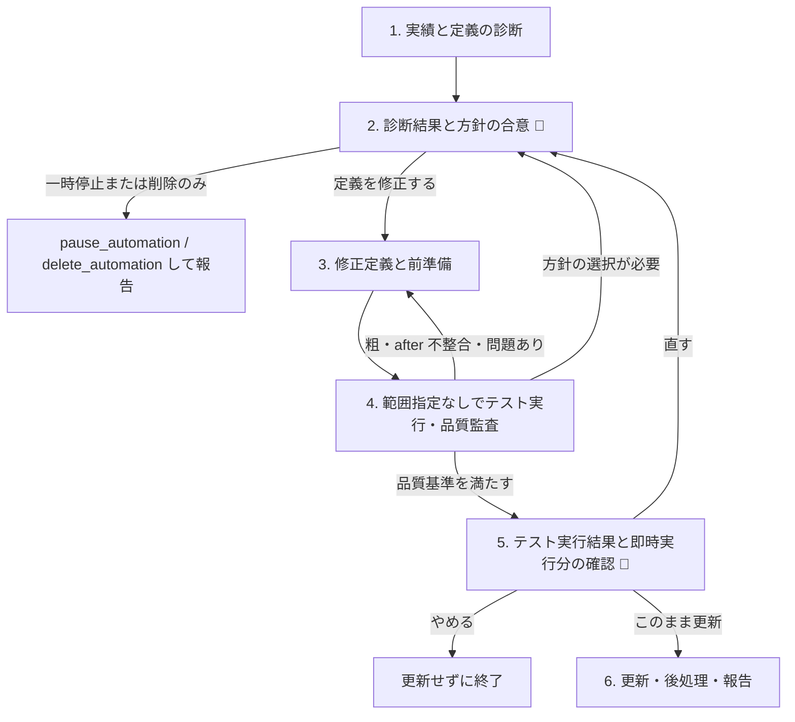

# 修正・診断・品質監査の手順

既存の自動化の不具合修正・ノイズ削減・品質引き上げ・一括監査・一時停止・削除に使う。references/design.md の基準を前提に進める。

## 1. 実績と定義の診断

推測で直さず、Orbe の実績データから根本原因を特定する。

- `list_automations` で今の `definition`・`version`・`paused`・各ノードの状態（`breach`・`lastRun`・`pending`・`accepted`・`dismissed`・`openProposals`）を読む。
- 対象ノード（品質監査なら全ノード）の過去の実行を `list_automation_runs` で読む（`failure`・`reasons`・`dropped`・`result`・所要時間）。`list_automations` の一覧には報告と作業の全文が出ないため、全文を確認したいときは `list_automation_runs` で `nodeKey` を指定し、少ない件数で読む。
- 判定を持つ自動化は `list_automation_proposals` で候補の中身と人の判断傾向（`accepted` と `dismissed` の比率、放置された `open` 候補、タイトルや理由の質）を読む。
- `list_workspaces` でタスク候補の紐付け先となる workspace 一覧を確認し、定義の中に削除済み workspace を指す箇所が無いか確かめる。
- 既存コマンドがローカルスクリプトを呼んでいる場合は、`workspace`（`list_workspaces` の rootPath）と `directory` から実パスを辿って Read で中身を確認する。必要なら副作用のない読み取りでプローブし、SKILL.md に記載された検証スクリプトのパス（check-jsonl.pl）でも検査する。

**診断の観点**:
- 失敗・形式違反: `failure`・`breach` の `reasons`・タイムアウト・MCP スコープ不一致・コマンド終了コード
- 取得の質: 情報不足（タイトルのみ等）・サイズ肥大・ノイズ未除外・`coverage` 誤り・`ORBE_SINCE` による増分取得の未実装や、決着を示す後続情報（スレッド返信・自分の応答等）の欠落
- 判定・報告の質: 棄却率の高さ・見落とし・曖昧なタイトルや薄い `reason`・`result.dismissed`（`alreadyProposed` / `noLongerCurrent` / `noOpenProposal`）の偏り・無意味な 0 件報告
- コストと構造: コマンドで済む処理への LLM 使用・過剰頻度・不要な上位モデル・`maxItems` / `maxAgeHours` / `retentionDays` 未設定

## 2. 診断結果と方針の合意

診断で分かった事実と根本原因を AskUserQuestion の question に書き、直し方の案を選択肢にして聞く（定義を変更する場合は、事前に `set_automation` の説明または orb automation --help で制約を確認しておく）。

- **一時停止・削除のみの依頼**: 一時的に止めたいだけならノードを定義から外さず `pause_automation` を使う案にする（外すと、出力した行・未読行・候補が消える）。一時停止または削除（`delete_automation`）だけで済むと合意できたら、手順 3〜5 を省いて実行し、結果を報告して終える。
- **新しく受け手（判定・報告・外部操作）を追加する、または既存ノードから既存ノードへの入力を追加するとき**: 既存の自動化に追加する接続からは、上流の `currentSet` にある既存の項目が全部届く（追加前の `newArrivals` のイベントは届かない。詳細は `set_automation` 説明の WHAT A RECEIVER READS）。既存の分も対象にするか、これから来る分だけにするかを選択肢に含める。
- **判定基準や出力構造を大きく見直すときの注意喚起**:
  - 既読行は定義変更だけでは自動で再評価されないこと、既に溜まった不要な `open` 候補は `currentSet` の取得結果から除外されれば自動で取り下げられるが、取得方式が `newArrivals` の場合や判定指示文の変更だけでは残ることを伝える。
  - スレッド単位で同一の `link` を使うことによる後続依頼のスキップ（人がタスク化・却下した候補の履歴保持中は同じ `link` が届かない）や、判定をコマンドにした場合の制約（人の確認待ちになっている既存候補の一覧が渡らず、どの候補を自動で対応済みにできるか把握できないこと）に関わる変更は、その影響も AskUserQuestion の question または選択肢の description に明記する。

## 3. 修正定義と前準備

1. `list_automations` の `definition` と `version` を取得し、変更を適用して全体を構成する。残すノードは `definition` 内の `id`（Orbe 付与の整数。`key` は定義内の識別名）を必ず保つ。
2. ローカルスクリプトを変更した場合は単体テストし、取得・処理コマンドは SKILL.md に記載された検証スクリプトのパス（check-jsonl.pl）へ通す（取得は --role fetch、処理は上流のサンプル行を標準入力に渡して --role process。判定へ流れるなら --judge を付ける）。
3. **追加した接続を「これから来る分だけ」にする `after` の設定**:
   - 既存ノードから読む接続のうち、今回の書き込みで追加したものに `after` を設定する（追加するノードの入力も、既存ノードに追加する入力も含む。「既存の取得 → 追加する処理 → 追加する判定」なら処理の入力）。同じ取得を読む他ノードへ影響するため、既存取得の条件は変えない。
   - 値は今の UTC 時刻（コマンド date -u +%Y-%m-%dT%H:%M:%SZ の出力）をそのまま設定する。
4. **既存行の見直し**: Orbe は定義変更を理由に既読行を自動で再評価しない（`set_automation` 説明の REWRITING）。既読行を新しい基準で判定し直したい場合は、入力の `take` を `all` に変えるなどして対象行が再び届く形に整える（既存の候補履歴ごとリセットしてよいと人が合意した場合だけ、ノードを `id` なしの新しい定義で作り直してよい）。

## 4. 範囲指定なしでテスト実行・品質監査

1. **テスト実行を行う**: `try_automation` に `automationId`・`version`・修正後の `definition` を渡す。
   - **範囲（`from`・`to`）を指定せずにテスト実行する。** 範囲を絞ると、本番で定義を保存した瞬間に動く分（`atWrite`）のうち範囲外のものがテスト実行結果に現れない。テスト実行で扱う行数を抑えたいときは、`try_automation` に少数の `rows` を直接渡すために範囲を絞るのではなく、範囲指定なしで `limit` を使う。
   - 取得 agent に書き込みツールが混ざっていないか先に確認する。
2. **完了まで待つ**: `wait` を true にし `timeoutMs` を明示して `get_automation_trial` を呼び、完了まで待ち切る（タイムアウトしたら再度待つ）。
3. **結果の読み込みと品質監査**:
   - 新規作成と同じ品質監査を行う（`failure` や出力形式違反の `reasons`・取得した行の情報密度と `link`・`proposals` のタイトル/理由/紐付け先 workspace/期限・提案されなかった行の見落とし・報告の 1 行目と 2 行目以降の本文・外部操作と作業の `held`・実測時間と `timeoutMinutes`）。
   - **`atWrite` の分離確認**: `atWrite` が付いた実行（本番で定義を保存した瞬間に即座に動く分。テスト実行では外部操作と作業は保留されるが、本番の保存時にはこれらも実際に動く）と、テスト実行がグラフの先頭ノードから行った実行を分けて読む。
   - **`after` の効果確認**: `after` を設定した接続の受け手について、このテスト実行での全実行（`atWrite` 含む）の `taken` の合計が、同じテスト実行でその上流が渡した行数を超えていないか確かめる。超えていなければ設定が効いている。ここで上流が渡した行数とは、上流の実行が出力した `rows`（`atWrite` 含む）の件数と、上流の実行の代わりにテスト入力として直接与えた `given` の `rows` の件数の合計を指す。除外した既存の分は受け手の `dropped` の `expired` に出る（1 行も受け取らなかった実行は残らない）。合計が上流の行数を超えていれば `after` が早すぎるため、時刻を取り直して再度テスト実行する。
   - **`result.dismissed` の切り分け**: `alreadyProposed`（同じ `link` の対応済みでない候補が既にある）・`noLongerCurrent`（読んだ後に元の行が無効になった）・`noOpenProposal`（対応済みにする対象の判断待ち候補が無い）は、判定基準の誤りとは別の、状態由来の破棄として区別して読む。
4. **自己修正**: 粗や `after` の不整合を見つけたら人に見せる前に直して再度テスト実行する。

## 5. テスト実行結果と即時実行分の確認

AskUserQuestion の question に、改善前との違いとテスト実行結果（候補の数・代表 2〜3 件・判定で不採用にした行の例・報告の要点・外部操作と作業の `held`・失敗有無）を具体的に書き、選択肢「このまま更新する／基準を直す／範囲や構成を直す／やめる」で聞く。

次が当てはまる場合は必ず question に説明を書き、直交する判断（再開有無・1 回実行有無）は同じ AskUserQuestion 内の**別の質問項目**として分けて聞く:

- **`atWrite` で即動く分**: 本番で定義を保存した瞬間に動く分（外部操作と作業も実際に動く）を、テスト実行がグラフの先頭ノードから実行した分と分けて明示する。
- **停止中（`paused`）の自動化・ノード**: 書き換えても停止したままになることを伝え、更新後に再開するか（自動化ごとか、どのノードか）を別質問で聞く。
- **`arrival` かつ `currentSet` の処理ノードの中身（`from`・`instruction`・`command`）を変え、テスト実行でその処理に `atWrite` の実行が無い場合**: その処理の項目と、その項目から作った候補は、上流が次に変わるまで前の結果のまま残る（`set_automation` 説明の REWRITING）。更新後にそのノードを 1 回実行して今の入力に対する結果へ差し替えるかを別質問で聞き、手段が agent なら 1 回分の費用がかかることも書く。
- **候補を出す自動化へ初めて変える場合**: 取得元で完了・解消した候補や判定が対応済みにした候補が、タスク画面の候補一覧から自動で取り下げられる仕組みを伝える。

## 6. 更新・後処理・報告

1. `set_automation` に `automationId`・読んだ `version`・修正後の `definition` を渡して更新する。`version` 不一致のエラーが返ったら `list_automations` で読み直し、変わった箇所を人へ伝えて手順 3 からやり直す。
2. 定義を保存した時点で動く分（テスト実行で `atWrite` が付いた実行）はすぐ動き、ほかのノードはスケジュールどおり実行される。今すぐ動かしたいと言われたら `run_automation` を使う。
3. 手順 5 で `arrival`＋`currentSet` の処理を今の入力で 1 回実行すると決めた場合: Orbe の `run_automation` は稼働中の `arrival` ノードを強制実行せず上流変化待ちのまま素通りするため、更新後に `pause_automation` でそのノードを一時停止し（既に停止中なら不要）、`run_automation` でそのノードを指定して実行する（経路上の取得も実行される）。完了後に再開する（停止のままにする合意なら再開しない）。
4. 手順 5 で再開すると決めた自動化・ノードは `pause_automation` で再開する。
5. 変更した点とノードごとの現状（手段・スケジュール・停止中なら次のスケジュールが無いこと）を 1 行ずつ報告して終える。
