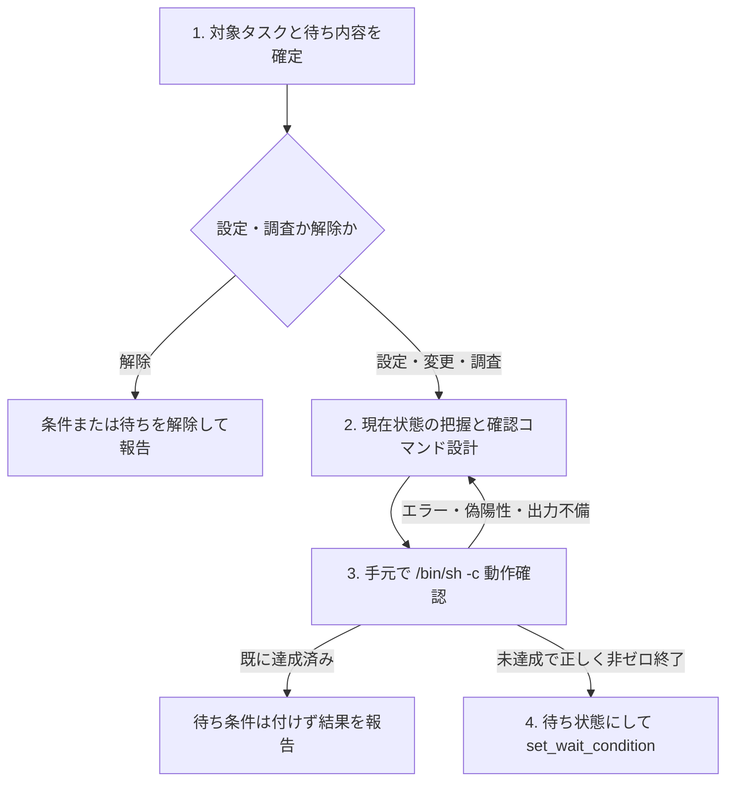

# wait — 誤検知のない「待ちの条件」を検証してから設定する

Orbe の待ちの条件（`set_wait_condition`）は、指定したシェルコマンドを人の承認なしにバックグラウンド（/bin/sh -c、rc ファイルは読み込まない）で繰り返し実行し、**終了コード 0 で終わった瞬間に待ちを解いて通知する**。解けたときに標準出力の 1 行目がタスク一覧の「起きたこと」と会話再開時の最初の入力になる。

目的は、**偽陽性（通信エラーや認証切れで誤って終了コード 0 になる）・偽陰性（達成済みなのに永遠に解けない）・読めない 1 行目出力（生 JSON や空行）** をゼロにした確認コマンドを、手元で動作確認してから設定することである。

## 常に守るルール

- **確認コマンドは厳格な読み取り専用にする。** 外部状態やローカルファイルを変更しない。
- **フェイルクローズ（偽陽性ゼロ）で書く。** API エラー・認証切れ・ネットワーク断・空出力で誤って終了コード 0 にならないよう、期待する値を明示的に照合して一致したときだけ終了コード 0 で終える。パイプ途中の失敗を握りつぶさない（出力を変数で受けて各コマンドの終了コードを明示的に判定するか、スクリプト内でエラー処理する）。
- **標準出力の 1 行目は人が一目で分かる短い状況要約にする。** 生 JSON やデバッグ文字列を出さない（例: 「PR #214 に @alice が APPROVED」「CI build-and-test が成功」）。補足 URL やコメント抜粋があれば 2 行目以降に出す。
- **登録前に必ず /bin/sh -c を使って手元で実行し、検証する。**
- **作業ディレクトリに依存しない形にする。** リポジトリ名や絶対パスを明示する。

## 手順

### 1. 対象タスクと待ち内容を確定する

- `list_tasks` で対象タスクを特定する。該当する既存タスクが無い場合は、`add_task` により待ち付きタスクを新しく作るか、関連する既存タスクへ待ちと条件を付けるかを決める（迷えば人に聞く）。実際のタスク作成や待ち状態への更新は、手順 3 の動作確認を通過したあと、手順 4 で行う。
- 完了済みタスクには待ちを付けられない。該当タスクが完了済みなら、新しいタスクを作るか人に聞く。既存の未着手・進行中タスクに別の `waitingReason` が既に付いている場合は、新しい待ち内容へ更新してよいか確認する。
- **解除の依頼**: 「自動確認だけ止めて待ち状態は残す」なら `set_wait_condition` の `condition` に null を渡し、タスクの待ち状態は残っていることを報告する。「待ち自体を終わらせる」なら `update_task` の `waitingReason` を null にする（曖昧なら人に聞く）。対象タスクに条件が付いていない場合はその旨を報告する。専用の読み取りスクリプトを作っていた場合は、残すか削除するかを人へ確認する。

### 2. 現在状態の把握と確認コマンド・間隔・期限の設計

- **ベースラインの把握**: 新しいレビュー・返事・ビルドといった今後の変化を待つ場合は、まず現在の状態（最新レビュー時刻や最新コメント ID、最新ジョブ ID など）を読み取りコマンドで 1 回調べ、過去の出来事で即座に終了コード 0 にならないようベースラインを条件へ組み込む。
- **`command`**: 認証済みの CLI（gh・curl 等）や読み取りスクリプトで状態を 1 回問い合わせる（/bin/sh -c で動く形にし、zsh 固有構文を使わない）。条件を満たしたときだけ、標準出力の 1 行目に要約を出して終了コード 0 で終了する。未達成やエラー時は非ゼロで終了し、何も出さないか、出す場合は標準エラーへ出す。
  - JSON を判定するときは jq -e 等で型・値まで厳密に照合し、空文字や null を真と誤認させない。
  - コマンド本体が複雑になるなら、`list_workspaces` で hasBoard が true の workspace（Orbe の Home）を特定し、その rootPath 配下にある scripts フォルダへ読み取り専用スクリプトを置き、絶対パスで呼ぶ。
- **`description`**: 何が起きたら解けるかの 1 行（例: 「PR #214 にレビューが付いたら」）。
- **`everyMinutes`**: 事象の速さと API 負荷の釣り合いで決める（例: CI や短いビルドは 2〜5 分、レビューや返事待ちは 10〜30 分、日単位の待ちは 60〜360 分など。必要もなく 1 分にしない）。
- **`deadline`**: 事象に見合う現実的な期限を決め（例: CI は数時間後、レビューや返事待ちは 1〜数営業日後など）、ISO 8601 形式（タイムゾーン省略時は Mac のローカル時刻）で表す。期限の見積もりが曖昧で大きく見誤ると困る場合は人に聞く。

### 3. 手元で動作確認する

登録前にコマンドを /bin/sh -c '<コマンド>' で 1 回そのまま実行し、終了コード・標準出力・標準エラーを確認する。

1. **認証・構文エラーが無いこと**: 標準エラーにコマンドが見つからないエラーや、未認証・構文エラー・API エラーが出ていれば直して再検証する。
2. **現在の状態との一致**:
   - 未達成の状態なら、確実に非ゼロで終了することを確かめる。
   - もしこの時点で終了コード 0 を返したなら、本当に条件が満たされているかを標準出力の 1 行目で確かめる。既に達成済みなら待ち条件は付けず、その事実を人へ報告して終える（条件式が緩すぎて偽陽性なら条件を厳しくして再検証する）。
3. **達成時の 1 行目出力の確認**: すべての確認コマンドで、条件を一時的に緩めたテストを行うか、サンプル JSON をコマンドに通すかして、達成時に終了コード 0 で終了し、意図どおりの 1 行目が出ることを確かめる。

### 4. 待ち状態にして登録し、報告する

- 対象タスクがまだ待ち状態でなければ `update_task`（または新規なら `add_task`）で `waitingReason` を付ける。
- `set_wait_condition` で `taskId` と `condition`（`description`・`command`・`everyMinutes`・`deadline`）を登録する。
- 対象タスク ID・解ける条件・間隔・期限・登録した確認コマンドの要旨を簡潔に報告して終える。
